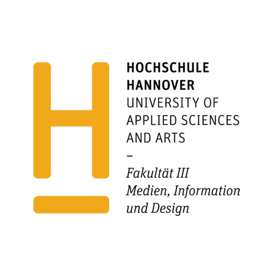
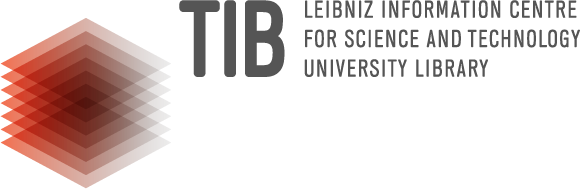
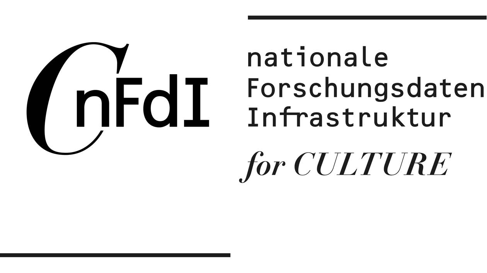

This book presents the work of the artist John Baldessari (1931--2020) as it is described in a linked-data knowledge graph. Every table and figure is generated from live data when the book is built:

- **OCR catalogue extraction**, which provides structured data extracted from the exhibition catalogue,
- the **CPS Wikibase** at <https://cps.tibwiki.io/>, which records artworks, materials, persons, exhibitions and their catalogue,
- **Wikidata**, which supplies context and shared identifiers, and
- the **Deutsche Nationalbibliothek (DNB)**, which supplies bibliographic records.

The book is written in [Quarto](https://quarto.org/) with Python and is published as a website, a PDF, a Word document and an ePUB. The source code and the build workflow are on [GitHub](https://github.com/NFDI4Culture/Baldessari).

::: {.callout-note}
The data are a work in progress. The CPS Wikibase is edited continuously, so figures in this book reflect the state of the data on the build date shown on the title page.
:::

## How to read this book

[Chapter -@sec-introduction] describes the data sources and the data model. The first part, [Exhibition catalogue](exhibition-catalogue.qmd), presents the exhibition, the artist, the catalogue and the works on view for curators. The chapters in the next part follow the item types of the CPS Wikibase: artworks, paintings, photographs, films, materials, persons, and exhibitions with their catalogue. The following part connects the CPS data to Wikidata and the DNB, and the following parts document OCR extraction and data portability. The final part, [A How-to](how-to.qmd), explains in three steps how to publish an exhibition as a public record on Wikidata.

## Copyright and licensing

All materials here are open-licensed unless otherwise stated and follow FAIR data principles and the UNESCO Recommendation on Open Science [@unesco2021openscience].

**Source catalogue.** The exhibition data is extracted from the printed catalogue *Baldessari: while something is happening here, something else is happening there: works 1988–1999* (Köln: Verlag der Buchhandlung Walther König, 1999), ISBN [978-3-88375-396-6](https://www.tib.eu/de/suchen/id/gwlb:302796398?cHash=d9b2700b8cf3934df61d65f43f2e6278), DNB record <https://d-nb.info/957409494>. Texts by Meg Cranston, Diedrich Diederichsen and Thomas Weski; published for the exhibition at the Sprengel Museum Hannover and the Staatliche Kunstsammlungen Dresden, Gemäldegalerie Neue Meister. The catalogue, including its texts, photographs and reproductions of the artworks, remains protected by copyright held by the publisher, authors, artist and other rights holders. It is not republished here: only factual catalogue data (such as titles, dates, materials, dimensions and catalogue numbers) is extracted, and no catalogue texts or images are reproduced. The bibliographic record is provided by the Deutsche Nationalbibliothek under [CC0 1.0](https://creativecommons.org/publicdomain/zero/1.0/).

The project combines several licensing arrangements.

- The text, figures and generated content of this book are licensed under [CC BY 4.0](https://creativecommons.org/licenses/by/4.0/). The code is released under the MIT licence.
- The catalogue data extracted from the OCR work is released under [CC0 1.0 Universal](https://creativecommons.org/publicdomain/zero/1.0/), so the underlying data may be reused without restriction for research, teaching and public scholarship. Data published on Wikidata is also CC0.
- For research use, this project also recognises that text and data mining (TDM) may be permitted under the UK and German legal frameworks for scientific research, including UK copyright exceptions and the German research exception in § 60d UrhG. These provisions are jurisdiction-specific and do not replace a review of any third-party rights or source-specific conditions.

## Acknowledgements

[Linked Open Exhibitions](https://nfdi4culture.github.io/linked-open-exhibition/)

**Authors:** Simon Worthington (Hochschule Hannover – University of Applied Sciences and Arts (HsH); TIB – Leibniz Information Centre for Science and Technology and University Library) and Chloë Farr (TIB; University of Victoria).

A project made with the students of the Bachelor of Arts [Information Management (BIM)](https://f3.hs-hannover.de/en/courses/bachelor-studiengaenge/information-management-bim) of Hannover University of Applied Sciences and Arts in partnership with the [Computational Publishing Service](https://nfdi4culture.de/services/details/computational-publishing-service.html) from the Open Science Lab, [TIB](https://www.tib.eu/en/) – Leibniz Information Centre for Science and Technology and University Library, and with [NFDI4Culture](https://www.nfdi4culture.de/) – Consortium for Research Data on Material and Immaterial Cultural Heritage, as part of the National Research Data Infrastructure (NFDI).

{fig-alt="Hochschule Hannover" width=1.5in} {fig-alt="TIB" width=1.5in} {fig-alt="NFDI4Culture" width=1.5in}
